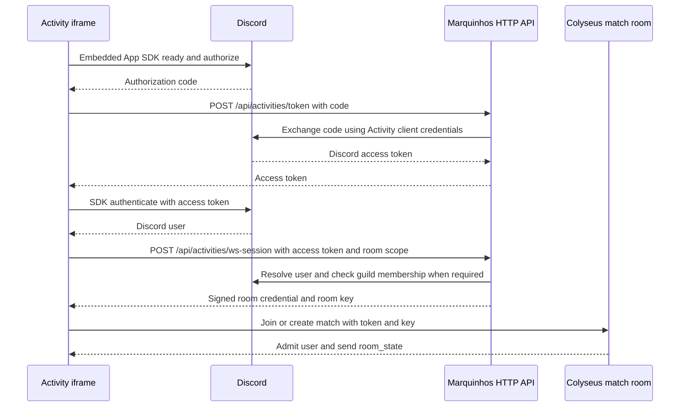

The Activity establishes Discord identity when its authentication module loads. React reads the identity store and can request a retry. The handshake starts before the React application mounts, so a rendering failure does not prevent Discord authorization from starting. [Activity authentication entry point and identity store](https://github.com/Devaneios/MarquinhosBOT/blob/main/apps/activity/src/platform/discord/auth.ts)

## Discord identity

The SDK requests `identify` and `guilds.members.read`. The HTTP API exchanges the authorization code using the Activity client credentials and returns the Discord access token. After SDK authentication, the iframe requires a guild ID and stores the user ID, guild ID, instance ID, and token for the rest of the Activity. Standalone development can use the SDK mock, which supplies a mock token and skips the code exchange. [SDK handshake](https://github.com/Devaneios/MarquinhosBOT/blob/main/apps/activity/src/platform/discord/auth.ts) · [Discord code exchange](https://github.com/Devaneios/MarquinhosBOT/blob/main/apps/api/src/integrations/discord/discord.service.ts) · [Activity HTTP contracts](https://github.com/Devaneios/MarquinhosBOT/blob/main/packages/contracts/src/http/routes/activity.ts)

## Room admission

`POST /api/activities/ws-session` resolves the Discord access token before issuing a five-minute room credential. Multiplayer sessions and daily Wordle require a guild membership check. `POST /api/activities/rooms` allocates a multiplayer room ID and returns the creator's credential directly. Multiplayer room keys identify the Activity instance, room, and game. Single-player and local keys include the authenticated user so players sharing an Activity instance get separate sessions. Card keys can also include a ruleset. [Activity controller and membership checks](https://github.com/Devaneios/MarquinhosBOT/blob/main/apps/api/src/modules/activity/activity.controller.ts) · [Token expiry](https://github.com/Devaneios/MarquinhosBOT/blob/main/apps/api/src/modules/activity/ws-session-token.ts) · [Room key construction](https://github.com/Devaneios/MarquinhosBOT/blob/main/apps/api/src/modules/activity/room-key.ts)

The Activity calls Colyseus `joinOrCreate('match', ...)` with the room credential and key. `MatchRoom.onAuth` verifies the credential, recomputes the key from the credential's identity, and checks it against the requested and target room. A multiplayer room that has switched games can still admit a credential for the same instance and room ID. Daily Wordle checks community access at admission. [Colyseus client connection](https://github.com/Devaneios/MarquinhosBOT/blob/main/apps/activity/src/platform/realtime/colyseus/connection.ts) · [Room admission and join state](https://github.com/Devaneios/MarquinhosBOT/blob/main/apps/api/src/realtime/MatchRoom.ts)

## Diagnose failures by stage

- **SDK identity fails or times out.** The client gives the handshake 15 seconds. On failure it clears the attempt and resets the SDK connection so a retry can start fresh. A missing guild ID means the player must launch inside a Discord server. [Authentication timeout and retry](https://github.com/Devaneios/MarquinhosBOT/blob/main/apps/activity/src/platform/discord/auth.ts)
- **The API refuses a room credential.** A `401` means Discord could not resolve the supplied token to a user. A `403` means the user failed the guild membership check. A `429` means the caller exceeded the shared Activity HTTP budget. [Activity access checks](https://github.com/Devaneios/MarquinhosBOT/blob/main/apps/api/src/modules/activity/activity-access.service.ts) · [Shared throttler](https://github.com/Devaneios/MarquinhosBOT/blob/main/apps/api/src/common/guards/shared-bucket-throttler.guard.ts)
- **Colyseus refuses admission after credential issuance.** Check whether the room credential expired and whether the request uses the matching room key. For multiplayer, compare the instance and room IDs on both sides. [Join implementation](https://github.com/Devaneios/MarquinhosBOT/blob/main/apps/activity/src/platform/realtime/colyseus/connection.ts) · [Room token and key checks](https://github.com/Devaneios/MarquinhosBOT/blob/main/apps/api/src/realtime/MatchRoom.ts)
