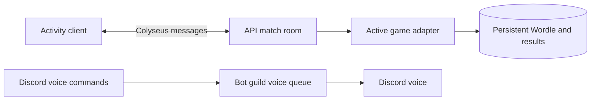

## Activity games

The API registers one Colyseus room type named `match`, filtered by `roomKey`. A multiplayer room can retain the connection while the host changes the active game between matches. The room owns the current adapter, members, queue and host assignments. Each adapter owns game-specific rules, message handling, and state synchronization. Some adapters offer seat rotation when a challenger is queued. [Server matchmaking](https://github.com/Devaneios/MarquinhosBOT/blob/main/apps/api/src/realtime/game-server.service.ts) · [Room lifecycle and seat controls](https://github.com/Devaneios/MarquinhosBOT/blob/main/apps/api/src/realtime/MatchRoom.ts) · [Adapter contract](https://github.com/Devaneios/MarquinhosBOT/blob/main/apps/api/src/realtime/GameRoomAdapter.ts)

The client shares one Colyseus connection across multiplayer views. A temporary transport drop can be handled by the SDK without immediately replacing the UI with a disconnect screen. Daily Wordle explicitly reserves the seat for 30 seconds and sends state again on reconnect. Other games implement their own departure and recovery behavior. For example, Pong uses server snapshots and explicit lobby sync, while its adapter forwards departures to the game session. [Client room provider](https://github.com/Devaneios/MarquinhosBOT/blob/main/apps/activity/src/features/rooms/connection/RoomConnectionProvider.tsx) · [Client connection lifecycle](https://github.com/Devaneios/MarquinhosBOT/blob/main/apps/activity/src/platform/realtime/colyseus/connection.ts) · [Pong room adapter](https://github.com/Devaneios/MarquinhosBOT/blob/main/apps/api/src/realtime/adapters/pongAdapter.ts)

## Discord music

The bot process owns the Discord player and its guild voice queues. A slash command consults the live queue and asks discord-player to search, insert, or play. Player events report playback and errors back to Discord. The API separately owns queued Last.fm scrobbles. Activity room APIs do not control the music queue. [Bot player](https://github.com/Devaneios/MarquinhosBOT/blob/main/apps/bot/src/lib/player.ts) · [Playback command workflow](https://github.com/Devaneios/MarquinhosBOT/blob/main/apps/bot/src/commands/music/utils.ts) · [API scrobble queue](https://github.com/Devaneios/MarquinhosBOT/blob/main/apps/api/src/integrations/lastfm/lastfm.service.ts)
