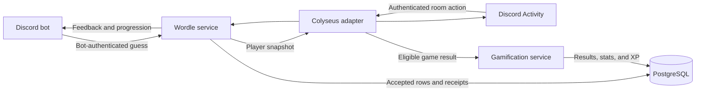

The bot and Activity use the same Wordle service. The API owns acceptance and persists the player's board by Discord user and Wordle date. Guild presence determines community credit separately. Bot commands can read the stored round through the session endpoint, while the Activity receives snapshots through the room adapter. [Wordle HTTP controller](https://github.com/Devaneios/MarquinhosBOT/blob/main/apps/api/src/modules/wordle/wordle.controller.ts) · [Wordle room adapter](https://github.com/Devaneios/MarquinhosBOT/blob/main/apps/api/src/realtime/adapters/wordleAdapter.ts) · [Global guess persistence](https://github.com/Devaneios/MarquinhosBOT/blob/main/apps/api/src/modules/wordle/gameplay/wordle-global-gameplay.service.ts)

## Accepted guesses and awards

A guess receipt lets a client replay an accepted request after losing its response. Accepted rows commit before achievement evaluation. Pending award work is retained so it can be retried after a failure. The player's private overview can include achievement evidence that public views filter before returning it. [Global game coordinator](https://github.com/Devaneios/MarquinhosBOT/blob/main/apps/api/src/modules/wordle/gameplay/wordle-global-game-coordinator.ts) · [Reconciliation runbook](https://github.com/Devaneios/MarquinhosBOT/blob/main/docs/wordle-operations.md) · [Public player overview](https://github.com/Devaneios/MarquinhosBOT/blob/main/apps/api/src/modules/wordle/progression/wordle-player-overview.service.ts)

## Match results and guild XP

Eligible multiplayer games send placements to the gamification service. The result ID binds a match to its guild and game type. A result can add an unrecorded player to an existing match, while a repeat for a recorded player leaves their XP and counts alone. A collision with a different guild or game type fails the transaction. Per-guild levels and leaderboard positions come from persisted XP and result records. [Gamification transactions and ranking](https://github.com/Devaneios/MarquinhosBOT/blob/main/apps/api/src/modules/gamification/gamification.service.ts) · [Result input and responses](https://github.com/Devaneios/MarquinhosBOT/blob/main/packages/contracts/src/http/routes/gamification.ts)
