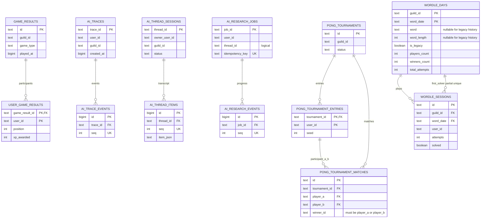

# Data model

The PostgreSQL schema is split by feature. Solid relationships below are enforced with foreign keys. Relationships labelled `logical` are joined by application code because they can be created before the referenced entity exists or because they are not owned by the parent row.

`user_game_results` keeps its composite primary key `(game_result_id, user_id)`. Its server is derived from the parent `game_results` row, so code does not write a second `guild_id`. The `(user_id, game_result_id)` index supports user history lookups. The legacy `guild_id` column is still present (nullable, filled by a trigger) until the contract release; see [Rollout](#rollout-expand-then-contract).

The AI child tables cascade when their trace, thread, or research job is deleted. Each event stream has a unique `(parent_id, seq)` constraint, which also serves ordered reads. Research jobs keep `thread_id` as a logical reference because quota checks may reject a job before a thread session is created.

Tournament match participant keys reference entries using `(tournament_id, user_id)`. Nullable players preserve byes and empty pending matches. A non-null winner must match one of the two participants.

Wordle challenge metadata lives once per server and date. Historical rows can retain sessions and metrics while storing an unknown answer or length as `NULL`. Once the contract release lands, sessions reference their day with a restrictive composite foreign key; until then a trigger creates a missing day row for each session. The session's user/server/date uniqueness and the partial first-solver uniqueness remain in place.

The [daily Wordle implementation reference](wordle.md) describes guess transactions,
counter updates, streaks, achievement awards, and the Wordle-specific import behavior.

User ownership fields such as `user_id`, `owner_user_id`, and `guild_id` are intentionally not foreign keys to the `users` table: Discord identities can appear in domain data before profile rows are created, and the existing user deletion service removes owned records explicitly.

## Rollout: expand, then contract

The schema change ships in two releases so that rolling back is "redeploy the previous image", never a database restore.

**Expand (migrations 0004 and 0005).** Purely additive: new indexes, cascade and composite foreign keys, unique sequence constraints, the pong winner check, and the new `wordle_days` table (backfilled from `wordle_daily` and `wordle_sessions`). The previous release's objects stay, kept consistent by triggers:

| Legacy object                           | Kept in sync by                                                                               |
| --------------------------------------- | --------------------------------------------------------------------------------------------- |
| `user_game_results.guild_id` (nullable) | `user_game_results_fill_guild` fills it from `game_results`                                   |
| `wordle_daily`                          | `wordle_days_to_daily` and `wordle_daily_to_days` mirror each other; the newest day wins      |
| `wordle_sessions.word_length`           | `wordle_sessions_fill_day` fills it from the day, and creates a legacy day row if none exists |

`packages/database/src/integrity.test.ts` runs statements shaped like the previous release against the migrated schema to keep this true.

**Contract (a later migration, shipped after the expand release has proven stable).** Drops the triggers and functions above, `wordle_daily`, `wordle_sessions.word_length`, `user_game_results.guild_id` and `idx_user_game_results_user`, and adds the `wordle_sessions_day_fk` foreign key. Before it runs, `db:audit` must report no `game_result_guild_mismatch` or `wordle_day_conflicting_lengths` issues. This is the only release that needs a maintenance window, `MIGRATION_BREAKING=1` and a restore-based rollback; see the Rollback section of the deployment guide.
