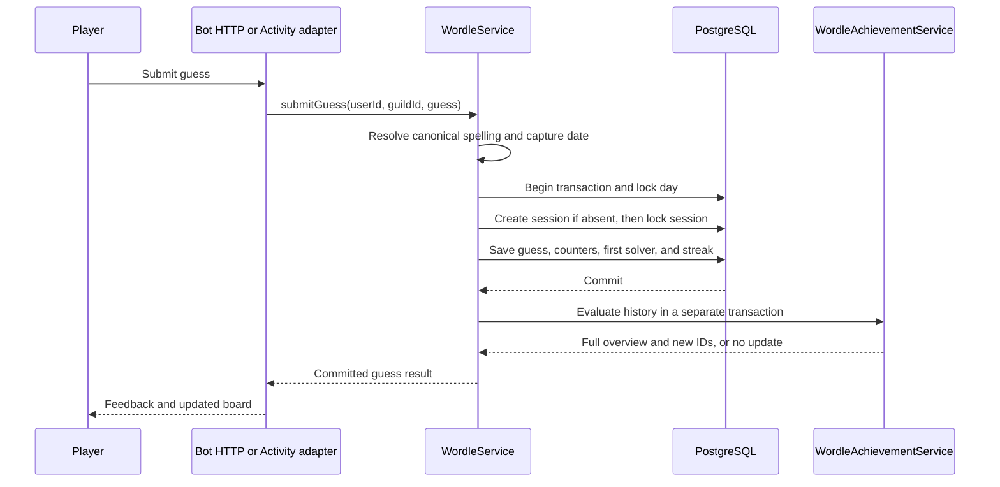

# Daily Wordle implementation

Terminhos is the daily Wordle game shared by the Discord bot and the Activity.
Each guild has one answer per date. Each player has a private session for that
guild and date, with no attempt limit.

This reference describes the current implementation. [Operate daily Wordle](wordle-operations.md)
covers configuration, word lists, achievement backfills, and verification.

## Source map

The implementation is split across these modules.

| Responsibility                                                                      | Source                                                                                                                                                                         |
| ----------------------------------------------------------------------------------- | ------------------------------------------------------------------------------------------------------------------------------------------------------------------------------ |
| Daily answers, guesses, counters, streaks, rankings, announcements, and word review | [`WordleService`](../apps/api/src/services/wordle.ts)                                                                                                                          |
| Day boundary                                                                        | [`wordleDate.ts`](../apps/api/src/services/wordle/wordleDate.ts)                                                                                                               |
| HTTP contracts                                                                      | [`http/routes/wordle.ts`](../packages/contracts/src/http/routes/wordle.ts)                                                                                                     |
| HTTP authentication and handlers                                                    | [`wordle.route.ts`](../apps/api/src/routes/wordle.route.ts), [`WordleController`](../apps/api/src/controllers/wordle.controller.ts)                                            |
| Shared payloads and keyboard configuration                                          | [`contracts/wordle.ts`](../packages/contracts/src/wordle.ts)                                                                                                                   |
| Activity messages                                                                   | [`activity/games/wordle.ts`](../packages/contracts/src/activity/games/wordle.ts)                                                                                               |
| Colyseus integration                                                                | [`wordleAdapter`](../apps/api/src/realtime/adapters/wordleAdapter.ts)                                                                                                          |
| Letter feedback and keyboard state                                                  | [`feedback.ts`](../packages/domain/src/games/wordle/feedback.ts), [`keyboardState.ts`](../packages/domain/src/games/wordle/keyboardState.ts)                                   |
| Achievement definitions, pure evaluators, and history                               | [`achievements/`](../packages/domain/src/games/wordle/achievements), [`playerStats.ts`](../packages/domain/src/games/wordle/playerStats.ts)                                    |
| Achievement persistence and rewards                                                 | [`WordleAchievementService`](../apps/api/src/services/wordle/WordleAchievementService.ts), [`AchievementService`](../apps/api/src/services/gamification/AchievementService.ts) |
| Database tables                                                                     | [`schema/wordle.ts`](../packages/database/src/schema/wordle.ts), [`schema/gamification.ts`](../packages/database/src/schema/gamification.ts)                                   |
| Activity screens and state                                                          | [`games/wordle/`](../apps/activity/src/games/wordle)                                                                                                                           |
| Player settings                                                                     | [`WordleUserConfigService`](../apps/api/src/services/wordleUserConfig.ts)                                                                                                      |
| Discord command and API client                                                      | [`termo.ts`](../apps/bot/src/commands/games/termo.ts), [`marquinhosApi.ts`](../apps/bot/src/services/marquinhosApi.ts)                                                         |
| Discord images and scheduled messages                                               | [`screens/termo.ts`](../apps/bot/src/ui/screens/termo.ts), [`ready.ts`](../apps/bot/src/listeners/ready.ts)                                                                    |
| Legacy import                                                                       | [`importSqlite.ts`](../packages/database/src/etl/importSqlite.ts)                                                                                                              |

## Daily answer and word banks

`getRecifeDate()` returns `YYYY-MM-DD` in `WORDLE_TIMEZONE`, which defaults to
`America/Recife`. Daily answer selection, session lookup, rankings, streaks,
announcement claims, and achievement evaluation use this date helper.

`getDailyWord(guildId)` reads `wordle_days` for the current date. If the row or
playable answer is missing, it calls `pickNewWord` with `ifStale` and reads the
day again. Concurrent callers keep the answer already stored for that date.

The API loads these word banks into process memory.

| File under `apps/api/`   | Use                                                          |
| ------------------------ | ------------------------------------------------------------ |
| `devaneios-wordlist.txt` | Preferred answer bank for 75% of selections, before fallback |
| `wordlist.txt`           | Preferred answer bank for the other 25%, before fallback     |
| `valid-guesses.txt`      | Accepted guesses and canonical spellings                     |

Daily answers have five or six letters. Selection excludes banned words and
entries in `wordle_used_words`. That table is global, so an answer used by one
guild is excluded from later selections in other guilds. Selection reads the
used-word set before its write transaction. Simultaneous selections for different
guilds can still choose the same word.

The picker falls back to the other bank when the preferred bank has no available
answers. It selects an available length uniformly, then selects a word uniformly
within that length. Fewer than 50 available words in the selected bank produces
a warning. An empty pool produces `No available words left in the wordlist`.

[`build-valid-guesses.ts`](../apps/api/scripts/build-valid-guesses.ts) builds the
validation bank from both answer banks and generated Portuguese plural forms.
It retains words of length 5 through 12, removes duplicates, and sorts the output.
Daily guesses must still match the current answer length.

`resolveCanonical()` trims and lowercases input. An exact validation-bank match
wins. Otherwise, lookup ignores diacritics and prefers an accented entry when
spellings share the same unaccented form. Unknown words are rejected.

Daily scoring removes diacritics from both the canonical guess and the answer.
Stored guesses keep the canonical spelling. Repeated guesses are rejected by
their spelling without diacritics. `computeFeedback()` marks exact positions
first, then consumes remaining matching letters once each for `present` feedback.
Other letters receive `absent` feedback.

## Guess persistence

The bot and the Activity submit guesses to the same service.

`submitGuess()` validates the word before opening a transaction. It captures the
session date before the transaction, so the day and session writes use the same
date even if the request waits on a lock.

The transaction locks the guild's day row with `SELECT ... FOR UPDATE`. If no
playable day exists, selection runs inside the transaction and the service locks
the resulting day. The service rejects a guess whose canonical length differs
from the answer length.

The service inserts an empty session with `ON CONFLICT DO NOTHING`, then locks
the session row. The unique user, guild, and date key prevents duplicate sessions.
The day lock serializes guesses in the same guild and date, including guesses
from different users.

An already solved session rejects further guesses. A duplicate guess also fails
without adding an attempt. Accepted guesses update the serialized guess history,
attempt count, solved flag, and `solved_at`. A solve also updates the player's
streak in the same transaction.

The first solve sets `first_solver` if no other session has that flag for the
day. The service checks sessions rather than `winners_count`. A partial unique
index permits only one `first_solver = true` per guild and date.

Achievement evaluation starts after the guess commits. An award failure logs
`wordle.achievements.award_failed` and leaves the guess result intact. The
optional `achievementUpdate` is present only when award evaluation succeeds.

## Counters, streaks, and rankings

The day row stores these counters.

| Counter          | Update                                                                       |
| ---------------- | ---------------------------------------------------------------------------- |
| `players_count`  | Increments on a player's first accepted guess, including a first-guess solve |
| `winners_count`  | Increments when a player solves                                              |
| `total_attempts` | Adds the solving player's full attempt count when the player solves          |

`getDailyStats()` reports the current date, answer length, player count, winner
count, and average attempts. The average includes winners only and rounds to one
decimal place. With no winners, the average is zero.

`wordle_streaks` stores each player's current streak, maximum streak, and last
solved date within a guild. A solve on the next consecutive date extends the
streak. A gap resets it to one. A repeated update on the same date preserves the
stored value. Without a stored streak row, the service derives consecutive solved
dates from session history. A streak read returns zero for the current streak
when the last solve is older than yesterday, while preserving the stored maximum.

`getGroupStreak()` counts consecutive dates with any session in the guild, ending
yesterday. It excludes today and does not require a solve.

The HTTP leaderboard returns at most ten players and adds `groupStreak` outside
the `data` array.

| Period     | Dates                                   | Ordering and score                                                        |
| ---------- | --------------------------------------- | ------------------------------------------------------------------------- |
| `daily`    | Today, or the supplied `date`           | Solved sessions first, then fewer attempts, then earlier session creation |
| `weekly`   | Today and the preceding six dates       | Lowest average score first                                                |
| `monthly`  | From the first day of the current month | Lowest average score first                                                |
| `all-time` | All recorded dates                      | Lowest average score first                                                |

For periods other than `daily`, participating users are those with a session in
the period. Eligible dates have a positive answer length and at least one guild
session. A user's score for a date is the session's attempt count, even if
unsolved. A missing session scores `word_length + 1`. `avgScore` averages those
scores over all eligible dates and rounds to two decimal places. `totalDays` is
the number of eligible dates, including dates the user missed.

## Achievements and player statistics

[`WORDLE_ACHIEVEMENT_CATALOG`](../packages/domain/src/games/wordle/achievements/catalog.ts)
contains 110 explicit achievement objects: 59 drawings and seven collection
milestones. Each object owns its visible metadata and pure evaluator. The
`wordle_v2_` prefix remains part of the stable IDs; there is no runtime
achievement version, activation boundary, or session version filter. Existing
eligible sessions participate in the collection.

API startup seeds the Wordle metadata into the shared `achievements` table.
Wordle evaluators are TypeScript functions and are not stored as serialized
conditions, so Wordle rows have `condition = null`. Generic achievements keep
their serialized conditions. The catalog source is authoritative for Wordle
metadata and behavior.

[`analyzeWordleAchievements()`](../packages/domain/src/games/wordle/achievements/engine/evaluate.ts)
prepares dated history and exposes pattern discovery and evaluation over the
same facts. Dates after today are filtered out; eligible dates are sorted and
deduplicated. Valid counters can contribute numerical progress when a board is
malformed, but the whole board is withheld as evidence. Submitted board evidence
requires complete rows of the answer width and, for a solved session, a final
all-green row. A valid zero-attempt draft win contributes to wins, streaks, and
numerical milestones but has no feedback rows to supply board evidence. Goals
that require an accepted guess, such as participation streaks, use only dates
with submitted guesses.

The catalog includes solve and participation milestones, streaks, calendar
coverage, exact attempt counts, feedback challenges, vocabulary goals, and
drawings. `wordle_v2_devaneios_rows` derives its `DEVANEIOS` prefix separately
for each guess row: only green letters in column order advance it; an unreached
row preserves its prefix; a played row that makes no progress resets only
itself and can start again with `D`. The longest current row prefix is returned
as capped progress out of nine. A valid zero-guess win has no row and neither
adds letters nor resets one.

Drawings are explicit objects in
[`content/patterns/`](../packages/domain/src/games/wordle/achievements/content/patterns).
They include alphabet letters, digits, seven tetrominoes, and the authored
shapes. The matcher recognizes the complete same-color figure: another cell of
that color touching it, including diagonally, changes the drawing. Green and
yellow are checked independently. Tetrominoes can rotate without reflection;
letters and digits stay upright. The winning row is excluded as a neighbor
unless the drawing itself uses it. Drawings can be recognized during an
unfinished game. The matcher and witness verifier support six-column masks.
Every mask and variant has separate green and yellow legal witnesses checked
through production `computeFeedback()`.

`wordle_pattern_discoveries` stores the first witness per player, guild, and
pattern ID, with its source session and feedback snapshot. Repeated colors,
dates, positions, and orientations do not increase collection progress. The
snapshot contains feedback and matched coordinates, not the guess or answer.

An accepted guess commits before achievement awarding. In its separate
transaction, `checkAndAward()` takes a player-and-guild lock, loads history once,
prepares one analysis, discovers unknown patterns, persists their first
witnesses, reloads persisted discovery IDs, evaluates the catalog once, and
grants XP in one batch for newly inserted unlocks. A failed achievement update
does not reject the already accepted guess. The guess result carries one
optional `achievementUpdate` with the complete overview and newly unlocked IDs.
A later accepted guess or explicit backfill can reconcile a missed award.

`getOverview()` is read-only: it evaluates against persisted discoveries but
does not match patterns, insert unlocks, or grant XP. Hidden achievements keep
their metadata concealed until unlocked. `holdersPercent` counts distinct
players in the guild with an accepted guess or a valid zero-guess win.

Activity saves the current draft with optimistic revisions and restores its
cells and active position on reconnect. The bot saves text delivered through
`/termo` autocomplete, including short or cleared values when Discord sends
those events; input never delivered to the bot cannot be persisted. When the
configured Wordle date closes, a saved final draft becomes a zero-attempt win
only if it still equals that day's normalized answer and the player has no
accepted guesses. A background finalizer checks after startup and every 30
seconds, then records the win, streak, daily counters, statistics, and award
retry state. Typing alone does not reveal correctness, start the guess timer,
or change the streak.

Player statistics are derived by
[`computeWordlePlayerStats()`](../packages/domain/src/games/wordle/playerStats.ts).

| Field           | Meaning                                                                                    |
| --------------- | ------------------------------------------------------------------------------------------ |
| `played`        | Dates with an accepted guess or a valid zero-attempt draft win                             |
| `wins`          | Solved dates, including a valid zero-attempt draft win                                     |
| `winRate`       | Rounded integer percentage of played dates solved                                          |
| `currentStreak` | Latest consecutive solved run if its last date is today or yesterday                       |
| `bestStreak`    | Maximum of historical solved runs and the persisted streak maximum supplied by the service |
| `distribution`  | Solved counts in eight buckets: `0`, `1`, `2`, `3`, `4`, `5`, `6`, and `7+` attempts       |

Wordle session times use epoch seconds. Achievement unlock times use epoch
milliseconds in the database and ISO datetime strings in Wordle payloads.

## HTTP contracts and authentication

[`wordle.route.ts`](../apps/api/src/routes/wordle.route.ts) mounts at
`/api/wordle`. Except for user settings, every route uses `checkToken` with the
server-side `MARQUINHOS_API_KEY` in the authorization header. The key authorizes
the supplied user and guild IDs. The `/admin` path adds no separate role check.
The bot registers `/admin` with Discord's Administrator permission by default.

User settings use `verifyActivityDiscordToken` with a Discord access token in
`Authorization: Bearer <token>`. The verified Discord user owns the settings row.
The request does not select another user.

The following paths are relative to `/api/wordle`. Contract definitions are in
[`http/routes/wordle.ts`](../packages/contracts/src/http/routes/wordle.ts).

| Method | Path                             | Input beyond path parameters                                  | Success response                                            |
| ------ | -------------------------------- | ------------------------------------------------------------- | ----------------------------------------------------------- |
| `POST` | `/guess`                         | Body: `userId`, `guildId`, `guess`                            | `{ data: WordleGuessResult }`                               |
| `POST` | `/draft`                         | User/guild, date, row, cells, active index, expected revision | `{ data: WordleDraftWriteResult }`                          |
| `GET`  | `/session/:userId/:guildId`      | None                                                          | `{ data: session or null }` for today                       |
| `GET`  | `/stats/:guildId`                | None                                                          | `{ data: WordleDailyStats }`                                |
| `GET`  | `/achievements/:guildId/:userId` | None                                                          | `{ data: WordleAchievementsOverview }`                      |
| `GET`  | `/streak/:userId/:guildId`       | None                                                          | `{ data: { currentStreak, maxStreak } }`                    |
| `GET`  | `/leaderboard/:guildId`          | Query: `period`, optional `date`                              | `{ data: entries, groupStreak }`                            |
| `GET`  | `/validate/:guildId`             | Query: `guess`                                                | `{ data: { valid, wordLength, message } }`                  |
| `GET`  | `/day-guesses/:guildId`          | None                                                          | `{ data: { word, wordDate, wordLength, guesses } or null }` |
| `POST` | `/admin/force-new-word`          | Body: `guildId`                                               | `{ data: { word, wordDate, wordLength, stats } }`           |
| `POST` | `/config`                        | Body: `guildId`, `channelId`                                  | `{ message }`                                               |
| `GET`  | `/config/:guildId`               | None                                                          | `{ data: { channelId } or null }`                           |
| `POST` | `/mark-announced`                | Body: `userId`, `guildId`                                     | `{ data: { claimed } }`                                     |
| `GET`  | `/unannounced/:guildId`          | None                                                          | `{ data: [{ userId, guesses, attempts }] }`                 |
| `GET`  | `/wordlist-pool-stats`           | None                                                          | `{ data: { total, used, remaining } }`                      |
| `GET`  | `/review/next`                   | None                                                          | `{ data: { word, index, total, done } }`                    |
| `POST` | `/review/decision`               | Body: `word`, `decision` as `keep` or `remove`                | Same shape as `/review/next`                                |
| `GET`  | `/user-config`                   | Discord access token                                          | `{ data: WordleUserConfig }`                                |
| `PUT`  | `/user-config`                   | Discord access token and full `WordleUserConfig` body         | `{ data: WordleUserConfig }`                                |

`WordleGuessResult` contains the canonical guess, its feedback, the complete
guess history, `solved`, `attempts`, and `wordLength`. A solve adds `streak`.
Successful achievement evaluation adds one optional `achievementUpdate`:
`{ overview, unlockedIds }`. Its `overview` is the full current collection and
statistics; `unlockedIds` identifies the achievements newly unlocked by this
guess. If award evaluation fails, this field is absent while the accepted guess
still succeeds. Draft writes return `saved` with the new draft, `conflict` with
the current draft or `null`, or `closed` after the date has finalized.

The leaderboard contract defaults an absent or invalid `period` to `all-time`.
Its optional `date` accepts the `YYYY-MM-DD` shape and affects only `daily`.
`getDayGuesses()` reads only today and does not create a day. Its output reveals
the answer and removes answer-equivalent and duplicate guesses without regard
to accents. Malformed entries are skipped by
[`buildUniqueDayGuesses()`](../apps/api/src/services/wordle/dayGuesses.ts).

Invalid requests and rejected guesses return HTTP 400 with `{ message }`.
Missing or invalid credentials return HTTP 401. Internal failures return HTTP 500. The Wordle-specific HTTP guess limiter in `index.ts` is commented out.

## Activity connection and screens

[`useWordleSession()`](../apps/activity/src/games/wordle/session/useWordleSession.ts)
requests `/api/activity/ws-session` with `game: 'wordle'` and `mode: 'single'`.
The API resolves the Discord user from the access token and mints a five-minute
session token. The room key is `instanceId:wordle:single:userId`.
[`MatchRoom`](../apps/api/src/realtime/MatchRoom.ts) verifies the token and room
key, then loads `wordleAdapter` in the shared Colyseus room type `match`.
Persistent progress remains keyed by user, guild, and date across Activity
instances and bot commands.

The adapter supports no bot or queue and declares `maxPlayers: 64`. Each guess
uses the authenticated token's user and guild IDs. The handler allows three
guess messages per one-second window. Accepted guesses and errors go only to
the submitting client.

The game protocol has these messages.

| Direction        | Type           | Payload                                                                                  |
| ---------------- | -------------- | ---------------------------------------------------------------------------------------- |
| Client to server | `guess`        | `{ guess }`                                                                              |
| Client to server | `draft_update` | Current date, row, cells, active index, and expected revision                            |
| Server to client | `init`         | Date, answer length, saved guesses, solved state, attempts, draft, and optional overview |
| Server to client | `guess_result` | `WordleGuessResult`, including optional `achievementUpdate`                              |
| Server to client | `guess_error`  | `{ message }`                                                                            |
| Server to client | `draft_result` | Saved draft, revision conflict, or closed-date result                                    |

`init` contains no answer. Achievement overview failure logs
`wordle.achievements.overview_failed` and still permits board initialization.
The adapter sends a non-player seat an empty session rather than saved guesses.

[`WordleGame`](../apps/activity/src/games/wordle/WordleGame.tsx) waits for both
the session token and user settings. The board remains on its connection screen
until `init` supplies a word length. A connection failure before `init` shows an
error screen.

[`useWordleBoard()`](../apps/activity/src/games/wordle/state/useWordleBoard.ts)
owns input, saved guesses, reveal timing, keyboard feedback, and achievement
updates. It restores the exact draft cells and active position from `init`, and
sends typing, deletion, paste, and positional edits through a serialized
revision queue. An accepted guess clears the input row and starts the next
draft row. Keyboard colors update after the new row finishes its reveal.
Restored guesses appear already revealed. Reduced motion makes the feedback
available immediately. Input and submission are disabled during the reveal,
after a solve, and outside the playing screen.

[`constants.ts`](../apps/activity/src/games/wordle/constants.ts) defines motion
and keyboard timing. Reveal duration is
`(wordLength - 1) * FLIP_STAGGER_MS + FLIP_DURATION_MS`. The board replaces its
saved collection and statistics from `achievementUpdate.overview`, then queues
the listed `unlockedIds` for toasts. It suppresses duplicate unlock IDs.
Opening the achievements screen dismisses the toast queue. Portuguese copy lives in
[`games/wordle.json`](../apps/activity/src/i18n/locales/pt-BR/games/wordle.json).

Settings belong to the Discord user across guilds. All settings default to false.

| Field              | Behavior                                                                                |
| ------------------ | --------------------------------------------------------------------------------------- |
| `invertActionKeys` | Swaps the on-screen Enter and Backspace positions                                       |
| `enableSounds`     | Enables keyboard sounds and the achievement chime                                       |
| `enableSpaceKey`   | Adds the on-screen space key and permits Space to move focus right                      |
| `enableArrowKeys`  | Adds on-screen navigation keys and permits physical left and right arrows to move focus |

Arrow keys require the space key. Both the Zod union and the database check
enforce this rule. Reads normalize old rows with space disabled to also disable
arrows. Updates replace the full settings object.

The sound setting remains part of the contract and storage, but its toggle is
currently commented out in `WordleSettingsScreen`.

## Discord commands and scheduled messages

`/termo palpite:<word>` submits through the bot's contract-derived API client.
The command requires a configured text channel and rejects play outside that
channel. Replies are ephemeral images with keyboard feedback and action buttons.
Without `palpite`, the command shows the player's existing board. Autocomplete
checks five- or six-letter input with `/validate` and records the value delivered
to the bot as a draft. It can persist short or cleared values only when Discord
actually sends those autocomplete interactions.

[`termoButtons.ts`](../apps/bot/src/interaction-handlers/termoButtons.ts)
handles board actions and the Activity link. `/termo-conquistas` returns an
achievement image and statistics through
[`termoAchievements.ts`](../apps/bot/src/commands/games/termoAchievements.ts).
The admin command provides `termo canal`, `termo novo`, `termo status`,
`termo leaderboard`, and `wordlist review` under `/admin`.

`ready.ts` starts the following tasks outside development mode.

| Task              | Schedule                                               | Behavior                                                                             |
| ----------------- | ------------------------------------------------------ | ------------------------------------------------------------------------------------ |
| Answer rotation   | Next midnight in `America/Recife`, then every 24 hours | Requests a crossword summary and ranking, forces a new answer, and posts its preview |
| Win announcements | Every 15 seconds                                       | Fetches today's solved sessions without an announcement claim                        |
| Status broadcast  | Every two hours                                        | Posts when the winner count exceeds the last broadcast count for the date            |

A slash-command solve and the win poller both claim a win before posting.
`markAnnounced()` updates `announced_at` only for a solved session whose field
is null. Exactly one caller receives `claimed: true`. A failure after that claim
can leave the win without a Discord message. There is no automatic retry of an
already claimed announcement.

The bot caches guild channel configuration in memory. `setWordleConfig()` updates
that cache, and startup preloads it. Direct API or database configuration changes
do not invalidate a running bot's cache.

## Storage model and SQLite import

The feature stores these records in PostgreSQL through Drizzle.

| Table                        | Key                                           | Contents                                                                                                           |
| ---------------------------- | --------------------------------------------- | ------------------------------------------------------------------------------------------------------------------ |
| `wordle_days`                | Guild and date                                | Answer, length, legacy flag, counters, and creation time                                                           |
| `wordle_sessions`            | Session ID, plus unique user, guild, and date | JSON text guesses, attempts, solved state, solve time, first-solver flag, draft-win marker, and announcement claim |
| `wordle_drafts`              | User, guild, and date                         | Current row cells, active position, optimistic revision, and day-end/reward reconciliation timestamps              |
| `wordle_pattern_discoveries` | User, guild, and pattern ID                   | First source session, discovery time, and feedback evidence snapshot                                               |
| `wordle_used_words`          | Word                                          | Global answer-use time                                                                                             |
| `wordle_streaks`             | User and guild                                | Current streak, maximum streak, and last solved date                                                               |
| `wordle_config`              | Guild                                         | Discord announcement and play channel                                                                              |
| `wordle_user_config`         | User                                          | Activity keyboard and sound settings                                                                               |
| `wordlist_review`            | Word                                          | Nullable ban decision and insertion-order `seq`                                                                    |
| `achievements`               | Achievement ID                                | Generic definitions and Wordle catalog metadata; Wordle condition is null                                          |
| `user_achievements`          | User, guild, and achievement ID               | Earned achievements and unlock times                                                                               |

`wordle_days` requires a positive length when present and an answer whose length
matches that value. A non-legacy row requires both fields. Legacy history can
retain unknown answers or lengths as null.

[`0003_wordle_achievements.sql`](../packages/database/drizzle/0003_wordle_achievements.sql)
adds solve timestamps and first-solver flags without inventing historical values.
[`0005_expand_wordle_days.sql`](../packages/database/drizzle/0005_expand_wordle_days.sql)
adds historical day rows and rejects conflicting answer lengths before migration.
The current expand release retains `wordle_daily` and
`wordle_sessions.word_length` for the previous image. Triggers mirror the latest
daily row and fill a session's legacy length or missing day row.

The session-to-day relationship does not yet have a foreign key. The composite
foreign key and removal of legacy objects belong to the later contract release
described in [data model rollout](data-model.md#rollout-expand-then-contract).

User IDs have no foreign key to a profile row. The
[`UserService`](../apps/api/src/services/user.ts) deletion transaction explicitly
removes a user's sessions, drafts, streaks, settings, and achievement unlocks.
It retains guild day rows and the global used-word history. Day counters are not
recomputed by that deletion.

During SQLite import, compatibility triggers derive day rows from copied daily
rows and sessions. `deriveWordleDayStats()` fills counters for days whose answer
is unknown. `wordlist_review.seq` preserves SQLite row order. Serial sequences
resume after imported IDs. The import and completion marker commit together.
The [deployment cutover procedure](deployment.md#sqlite-to-postgresql-cutover)
describes snapshots, startup failure, and rollback.

## Startup and deployment

[`index.ts`](../apps/api/src/index.ts) applies migrations before accepting traffic.
If `SQLITE_PATH` is configured, the one-time import runs next. Startup then
initializes gamification defaults, including the Wordle catalog, and loads bans.
It preloads `valid-guesses.txt` before the HTTP and Colyseus server starts. An
initialization failure or an unreadable validation bank stops the process.

The [API image](../apps/api/Dockerfile) generates the validation bank at build
time and copies both answer banks into the runtime image. The answer banks load
lazily on first use and stay cached for the process lifetime.
The [release Compose configuration](../deploy/docker-compose.yml) runs the API,
bot, PostgreSQL, and Activity gateway as separate services. The bot reaches the
API through `MARQUINHOS_API_URL`. The Activity uses the gateway's API and Colyseus
routes. Routing, secrets, backups, and release rollback are defined in
[deployment](deployment.md).

## Word review and reset behavior

The review queue is seeded from `wordlist.txt` only when `wordlist_review` is
empty. It advances in `seq` order through null decisions. `keep` stores false,
and `remove` stores true. A ban excludes future answer selections. It does not
remove the word from the validation bank or replace an answer already in play.
The answer picker reads bans from PostgreSQL.

`getWordlistPoolStats()` counts five- and six-letter entries in `wordlist.txt`
and subtracts the global used-word count. The total omits words found only in
`devaneios-wordlist.txt` and ignores bans. The used count includes both answer
banks, so `remaining` does not measure the actual pool available to the picker.

`forceNewWord()` replaces today's answer, deletes today's guild sessions and
drafts, and resets the day counters. It records the new answer as used and keeps
older used-word entries. It does not undo streak rows, achievement unlocks, or
XP.

## Current integration limits

The bot's midnight scheduler always uses `America/Recife`, even when the API's
`WORDLE_TIMEZONE` is overridden.

At midnight, `sendTermoCrossword()` requests `/day-guesses`, which reads the new
current date rather than the date that just ended. If no new day exists, the
summary returns null and the ranking receives no explicit date, so it also reads
the new day. If a new day already exists, the summary can expose that day's answer
before the scheduler forces another answer. The API supports a historical date
for daily rankings, but not for day-guesses.

An Activity board receives state on join and after its own guesses. There is no
daily-reset event or notification of a guess accepted through the bot or another
connection. A forced reset or date change can leave an open board showing stale
guesses or answer length until it receives fresh initialization.
